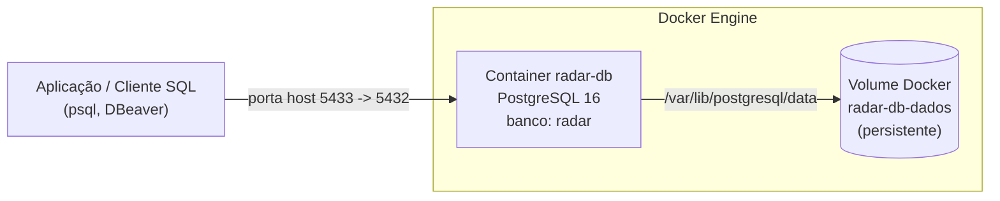

# Diagrama de Arquitetura — Lab Aula 9

Fluxo de persistência: a aplicação cliente (psql / DBeaver / qualquer cliente
SQL) conversa com o PostgreSQL rodando no container `radar-db`, que grava os
dados no volume Docker nomeado `radar-db-dados`. O volume sobrevive à remoção
do container, garantindo a persistência.



Texto equivalente (para ambientes sem renderização Mermaid):

```
Aplicação / Cliente SQL
        |
        v  (porta host 5433 -> 5432 no container)
Container radar-db  (PostgreSQL 16, banco "radar")
        |
        v  (/var/lib/postgresql/data)
Volume Docker: radar-db-dados  (persistente)
```

**Por que o volume garante persistência:** o diretório de dados do PostgreSQL
(`/var/lib/postgresql/data`) é montado no volume nomeado. Ao remover o
container com `docker compose down` (sem `-v`), o volume permanece; ao recriar
o container apontando para o mesmo volume, os dados reaparecem.
